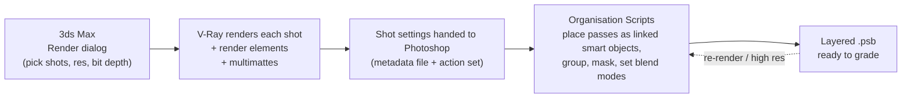

# HighVis

**3ds Max and Photoshop automation for architectural visualisation.**

Written between 2017 and 2021. Updated and improved in 2026 using Claude Code.

These tools are designed for my own workflow and software environment, and not intended/tested for public use. Implementing them in your own environment is not guaranteed or supported. This repository is mostly just a place to showcase my automation work, and to connect with any likeminded visualisers who stumble across it.

These automations cover the whole visualisation workflow: setting up a scene, modelling and asset prep in 3ds Max, rendering, and building the layered Photoshop file that the final image is graded in.

The centrepiece is a **one-click render-to-Photoshop workflow**. It pick the shots to render in 3ds Max, and when V-Ray finishes, Photoshop opens on its own and assembles every render pass into an organised, fully grouped `.psb`. Passes are linked smart objects, and adjustment masks come from named multimattes, meaning they can be automatically updated following a rerender. This also allows Photoshop work to be done on a low-res file, before carrying the work over to the high-res final render.

---

## Highlights

| | What it does |
|---|---|
| **Render → PSB pipeline** | Renders the chosen frames (shots) to their own folders, then has Photoshop place every pass as a linked smart object, set blend modes, build lighting/reflection/refraction/glass groups, turn multimattes into selection masks, and save a `.psb`. Re-renders (in place or to a new folder) and **High Resify** swap in new passes and keep every adjustment. |
| **Shot system** | Each frame of the timeline is a shot with its own camera, sun and sky. Hotkeys jump between shots, select the active shot's camera/sun/sky, lock cameras, and cycle viewport layouts around the shot camera. |
| **Material Guesser** | Tags materials in a library and auto-assigns them to imported geometry by matching object names against the tags. |
| **BetterMove** | A SketchUp-style two-click move tool for 3ds Max: pick a base point, pick a destination, snap and infer along axes and references, and type an exact distance. It works on objects and on Editable Poly/Mesh sub-objects. |
| **Asset library processing** | Batch-processes purchased model collections (e.g. Evermotion volumes): merges each file, attaches geometry, converts it to V-Ray proxies, names and numbers everything, and saves one clean scene per asset, ready for an asset browser. |
| **Photoshop grading shortcuts** | One-key scripts to build masked adjustment groups from the current selection or from a render pass (`A` overall, `D` diffuse, `S` sun, `X` specular…). Also: masks to group masks, vignettes, lighter/darker colour groups, entourage placement. |

## How it fits together



## Repository layout

```
3ds-max/
├── usermacros/                 Macros (hotkeys/toolbar buttons): Callis Scripts, Extras, BetterMove
├── scripts/
│   ├── Startup/Callis Scripts/ Runs at launch: default material, wire colours, auto-layering, camera lock
│   └── CallisScripts/scripts/  All Scripts.ms: the render pipeline, shots, Material Guesser, project setup
└── tools/                      Standalone utilities (run from Scripting ▸ Run Script)
    ├── Asset Library/
    ├── File Renaming/
    ├── Scene Organisation/
    └── Modelling/
photoshop/
├── Scripts/                    Pipeline scripts, grading shortcuts (Extras), export tools
└── Actions/Callis Scripts.atn  Action set that 3ds Max triggers to start the pipeline
```

Each folder has its own README with a description of every script:

- **[3ds Max →](3ds-max/README.md)**
- **[Photoshop →](photoshop/README.md)**

## Requirements

- Windows, **3ds Max** with **V-Ray** or **Corona** (render elements + multimattes)
- **Adobe Photoshop** CC 2018 or later (ExtendScript)
- Some asset tools use `sLib.ms` from Neil Blevins' free [SoulburnScripts](http://www.neilblevins.com/soulburnscripts/soulburnscripts.htm) (see [credits](#credits))

## Notes

These are production tools, kept as they were used: written for my own machine and folder conventions, not packaged as a product. Install paths are listed in each section's README. Inside the code the toolset still goes by its original working name, *Callis Scripts*: that is the name of the macro categories, install folders and action set, and of hard-coded paths such as `C:\Callis Scripts\` that the pipeline uses to pass settings between the two apps.

## Credits

- `sLib.ms` and the object-attach routine used by several asset tools come from **Neil Blevins' [SoulburnScripts](http://www.neilblevins.com/soulburnscripts/soulburnscripts.htm)**. They are not included here; install SoulburnScripts and copy `sLib.ms` to `scripts/CallisScripts/scripts/Libraries/Callis Scripts Library.ms`.
- Swift Loop, Select Similar and Show End Result macros wrap built-in 3ds Max commands.
- The Save As JPG dialog is adapted from a public Photoshop "Save As" dialog script.
