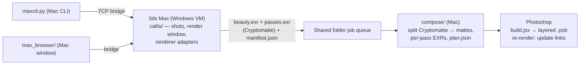

# HighVis

**3ds Max and Photoshop automation for architectural visualisation: a renderer-agnostic render → Photoshop pipeline, a shot system, and a cleaner, Fusion-style way of modelling.**

This is the current version, rewritten in 2026 in Python (`pymxs`). It is tested end to end with **V-Ray 7, Arnold and Corona 15**, and runs 3ds Max 2027 inside a Parallels VM on a Mac, driven from the Mac side over a small socket bridge. The original MAXScript + ExtendScript version (2017–2021) is kept in **[`legacy/`](legacy/README.md)**.

---

## Highlights

| | What it does |
|---|---|
| **Render → PSB pipeline** | Renders each shot at each resolution with its passes and **Cryptomatte**, then a Mac-side compositor splits the Cryptomatte into per-material and per-object mattes (6K, 500 materials: ~8 s), cropped to their bounds, and has Photoshop build a layered `.psb` of linked passes. A re-render updates the links and never rebuilds the file, so grading work survives. |
| **Renderer adapters** | One adapter per renderer maps its layers to canonical pass names (`callis/renderers.py`, `compose/recipes.json`), works around each renderer's quirks (Corona's VFB dump, V-Ray's half-float EXRs that wreck Cryptomatte ids, exposure scaling so passes sum to the beauty) and reports missing pieces as warnings instead of failing. |
| **Shots, not frames** | A shot is its own camera, size, per-shot object poses and "only in this shot" objects, with no animation keys. Replaces the old one-animated-camera system. |
| **Render window** | One floating window for picking shots and resolutions, region renders, quick renders and render presets. |
| **Fusion-style Max** | A clean mode (one key hides every toolbar and panel), trackpad orbit/pan/zoom from the Mac, a component Browser window, one Delete, one Copy/Paste, and a command-search palette that shares its code with my [Fusion tools](https://github.com/JoshCallis/fusion-360-tools). |
| **Smart modelling verbs** | One command per verb (Extrude, Bevel, Inset, Chamfer, Weld, Bridge, Cap, Slice, Detach, Shell…) that does the right thing for the object type and sub-object level. |
| **Move tool** | A SketchUp-style two-click Move with inference and Rhino-style axis locks, for objects and sub-objects. |
| **Material eyedropper** | Pick a material off one object and apply the last one to others, Fusion-style. |

## How it fits together



## Repository layout

```
max/
├── callis/          Runs inside Max: render, shots, render window, browser, move tool, smart verbs, clean mode…
├── compose/         Runs on the Mac: EXR → mattes → Photoshop plan; photoshop/*.jsx builds and updates the PSB
├── bridge_startup.py  In-Max TCP listener that runs jobs on Max's main thread
├── maxctl.py        Mac CLI: eval / run / maxscript / screenshot inside Max
├── palette/         Command-search palette (shared JS with the Fusion tools)
├── winlink/         Mac ⇄ Windows link (text-field focus, HUD relay)
├── install/         Max startup stubs
└── hotkeys/, materials/, maxstart/, scroll/   Config
max_browser/         The Browser window (Mac app + local server, long-polls Max's state)
legacy/              The original version (2017–2021): MAXScript macros + Photoshop ExtendScript
```

## Previous version

**[`legacy/`](legacy/README.md)** holds the original HighVis, with its full commit history: the MAXScript render pipeline, multimatte masks, the first BetterMove, the asset-library batch tools and the Photoshop grading shortcuts. The current version rebuilds that workflow, replacing per-material multimattes with Cryptomatte, animated cameras with standalone shots, and folder-name settings with JSON manifests.

## Notes

This is a working snapshot of a personal setup, not a packaged product: it assumes Max in a Parallels VM with this folder shared into it, and paths from the system it was built in. Inside the code the toolset keeps its working name, *Callis*.
